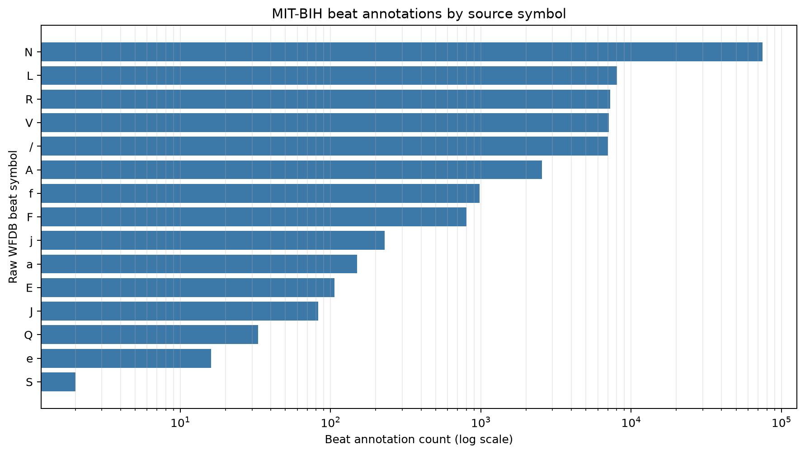
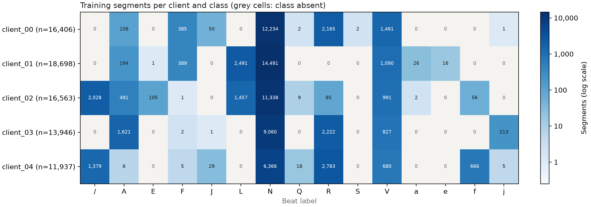
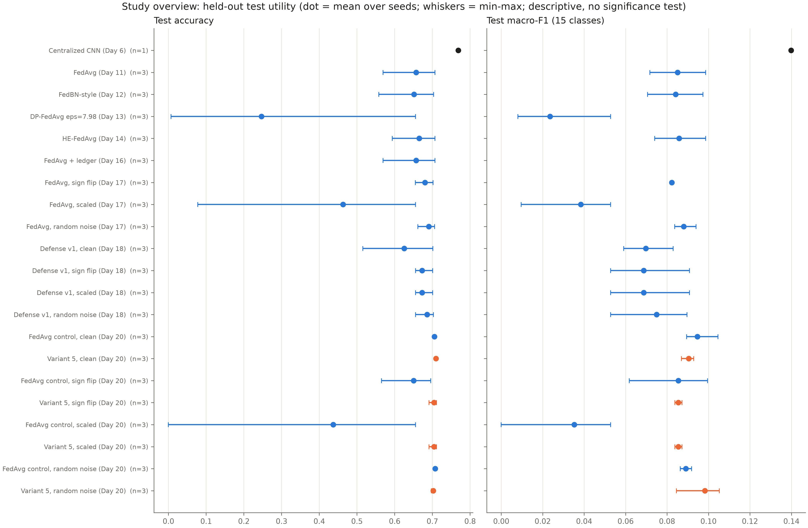
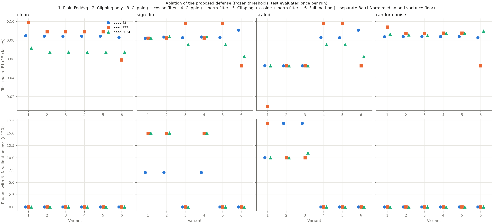
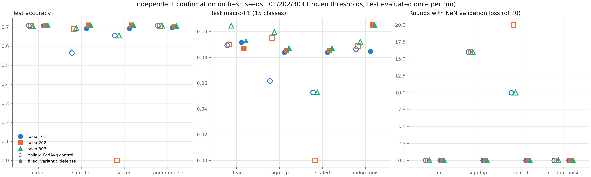
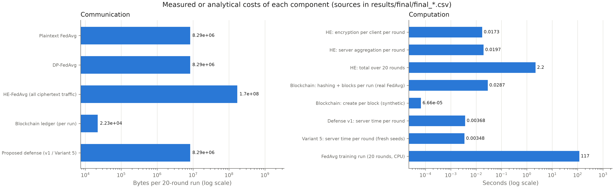

# Blockchain-Enabled Federated Learning for Privacy-Preserving Arrhythmia Detection

**A research prototype that measures what federated learning, differential privacy, homomorphic encryption, an audit ledger, and a robust aggregation defense each contribute, and cost, when training an ECG beat classifier on the MIT-BIH Arrhythmia Database.**

| | |
|---|---|
| **Status** | Historical study frozen 2026-10-05; versioned extensions are evaluated separately. |
| **Scope** | Simulated 5-client MIT-BIH training plus frozen external evaluation on SVDB; CPU research prototype |
| **Evidence** | Frozen study plus documented SVDB external evaluation, integrated HE+DP v1/v2, and a lifecycle-gated single-node ledger extension; see the requirement matrix for current evidence status. |
| **Not shown** | Clinical usefulness, diagnostic validity, statistical significance, or generalization beyond MIT-BIH |

**Post-freeze extensions:** preserve the v1 HE+DP three-seed experiment and its round-0 failure in [`docs/he_dp_integration.md`](docs/he_dp_integration.md). The separate v2 design and measured combined HE+DP v2 + lifecycle-gate run are documented in [`docs/he_dp_v2_protocol.md`](docs/he_dp_v2_protocol.md) and [`docs/blockchain_fl_integration.md`](docs/blockchain_fl_integration.md); the accountant is conditional on a trusted decryptor and ideal Gaussian draws, and the simulation does not enforce role isolation. The ledger is a single-node, single-process hash chain with no consensus, signatures, or replication. SVDB's frozen external evaluation and recovered split provenance are documented in [`docs/svdb_integration.md`](docs/svdb_integration.md). The seven-requirement evidence checklist is in [`docs/final_submission_report.md`](docs/final_submission_report.md); supervisor Requirement 4's intended blockchain role remains open.

---

## Contents

1. [Research aim](#1-research-aim)
2. [What the study does](#2-what-the-study-does)
3. [The data and the core challenge](#3-the-data-and-the-core-challenge)
4. [Results](#4-results)
5. [What this study does not establish](#5-what-this-study-does-not-establish)
6. [Getting started](#6-getting-started)
7. [Repository guide](#7-repository-guide)
8. [Documentation index](#8-documentation-index)

---

## 1. Research aim

Hospitals hold ECG data that could train better arrhythmia detectors, but privacy, regulation and ownership often prevent them from pooling it. Federated learning lets institutions train a shared model without exchanging raw ECG records. FL alone does not guarantee privacy, trustworthy coordination, or resistance to malicious participants, so this project examines each additional safeguard separately.

**Research questions**

| | Question |
|---|---|
| **RQ1** | How accurately can deep learning detect arrhythmias from ECG, centrally and federated? |
| **RQ2** | How does federated learning compare with centralized training under heterogeneous (non-IID) data? |
| **RQ3** | What do differential privacy and homomorphic encryption cost in utility, computation and communication? |
| **RQ4** | Can a blockchain-style ledger make federated training verifiable and auditable? |
| **RQ5** | Can a proposed aggregation mechanism fix an identified weakness at acceptable cost? |

## 2. What the study does

The original Day 20 study tested its components as **one-factor experiments**: one change at a time, against a matched baseline. A post-freeze run later combined the existing HE+DP v2 protocol with the lifecycle-gated ledger; it did not integrate the proposed defense and remains subject to the trust and scope limitations in the extension reports.

```text
                 MIT-BIH (48 records) -> filter -> beat windows -> 15 beat classes
                                            |
                 47 subject groups -> train / validation / test split (no subject overlap)
                                            |
          +--------------------+------------+--------------+-----------------+
          |                    |                           |                 |
   Centralized CNN      FedAvg, 5 clients            One-factor variants of FedAvg
   (reference)          (whole training groups)      +-- FedBN-style local BatchNorm
                                                     +-- Differential privacy (client-level)
                                                     +-- Homomorphic encryption (CKKS)
                                                     +-- Audit ledger (hash chain)
                                                     +-- Malicious client (3 attacks)
                                                     +-- Proposed robust aggregation defense
```

| Component | Design in one line | Details |
|---|---|---|
| Data pipeline | 0.5–40 Hz band-pass, 216-sample beat windows, per-window z-score; 109,460 segments | [preprocessing](docs/preprocessing.md), [splits](docs/dataset_splits.md) |
| Centralized baseline | 1D CNN with 10,127 parameters, frozen as the reference | [baseline](docs/baseline_freeze.md) |
| Federated learning | FedAvg, 5 clients built from whole subject groups, 20 rounds | [FedAvg](docs/federated_learning_baseline.md), [robustness](docs/fedavg_robustness.md) |
| Differential privacy | Client-level DP-FedAvg with an exact Gaussian-DP accountant | [DP](docs/differential_privacy.md) |
| Homomorphic encryption | The server adds up CKKS-encrypted updates it cannot read (TenSEAL / SEAL, 128-bit) | [HE](docs/homomorphic_encryption.md) |
| Audit ledger | A SHA-256 hash chain recording every client and global model hash per round | [ledger](docs/blockchain.md), [integration](docs/blockchain_fl_integration.md) |
| Attacks | One malicious client: sign flip, ×10 boost, or noise | [attacks](docs/malicious_clients.md) |
| Proposed defense | Update clipping plus cosine and norm screening against a robust median reference | [method](docs/proposed_method.md), [ablation](docs/ablation.md) |

## 3. The data and the core challenge



*Figure 1. MIT-BIH beat annotations per class (log scale). Normal beats (`N`, 75,028) outnumber the rarest class (`S`, 2) by more than four orders of magnitude. Only 8 of the 15 classes appear in the held-out test set at all. This imbalance is why accuracy alone is misleading, and why this study reports macro-F1.*



*Figure 2. How training data falls across the 5 simulated clients when whole subject groups are assigned. Grey cells are classes a client never sees. Paced (`/`) and `L` beats exist in only 2 training records each, so no client split can share them more widely. This is the natural non-IID setting every federated experiment uses.*

## 4. Results

Numbers are held-out test results and are **descriptive**: no significance tests were run. Most historical comparisons use 3 seeds; the combined HE+DP v2 run and SVDB external evaluation are single fixed-split runs. The SVDB checkpoint evaluation was reproduced once from a recovered copy of the same test membership to verify provenance, not to tune. The full tables and qualifications are in [`docs/final_results.md`](docs/final_results.md), [`docs/he_dp_v2_protocol.md`](docs/he_dp_v2_protocol.md), and [`docs/svdb_integration.md`](docs/svdb_integration.md).

### 4.1 Utility across every method



*Figure 3. Test accuracy and macro-F1 for every experiment (dot = mean over seeds; whiskers = min–max). The centralized CNN (black) sets the upper reference. Variant 5 of the proposed defense is in orange.*

| Setting | Accuracy | Macro-F1 | Reading |
|---|---:|---:|---|
| Centralized CNN | 0.769 | 0.140 | Reference. Weak on rare classes even here. |
| FedAvg (3 seeds) | 0.657 | 0.085 | All 37 clean federated runs fall below centralized; predictions collapse to mostly `N`/`V` |
| + Differential privacy (ε = 7.98) | 0.247 | 0.024 | Utility destroyed at this privacy level with 5 clients |
| + Homomorphic encryption | 0.665 | 0.086 | Utility preserved (aggregation error ≈ 10⁻⁷) |
| HE+DP v2 + lifecycle ledger (one run) | 0.655 | 0.053 | Round 0 selected; conditional privacy accounting; not evidence of useful trained-model utility |
| + Audit ledger | identical | identical | Recording does not change training (bit-identical) |

### 4.2 Robustness: what breaks FedAvg, and what fixes it



*Figure 4. Ablation of the defense. Variant 1 is plain FedAvg, variants 2–5 add components one at a time, and variant 6 is the full Day 18 method. The bottom row counts rounds in which the model produced invalid (NaN) outputs. A single malicious client breaks plain FedAvg under sign flip and ×10 scaling. The **cosine filter** stops the sign flip, and the **norm filter** stops the scaling. Clipping alone stops neither.*



*Figure 5. Independent confirmation on **fresh seeds** never used before (hollow = FedAvg, filled = Variant 5 defense, thresholds frozen in advance). Under attack, FedAvg breaks in 10–20 of 20 rounds. The defense keeps the model valid in every round, with no honest client wrongly flagged.*

| Fresh seeds 101 / 202 / 303 | FedAvg macro-F1 | Defense macro-F1 | Attacker detected | Honest clients flagged |
|---|---:|---:|---:|---:|
| No attack | 0.095 | 0.090 | — | 0% |
| Sign flip | 0.085 (model breaks after selection) | 0.085 (model stays valid) | 100% | 0% |
| ×10 scaling | 0.035 | 0.085 | 100% | 0% |
| Norm-matched noise | 0.089 | 0.098 | 5–10% | 0% |

### 4.3 Costs



*Figure 6. Communication and computation per component (log scales). Homomorphic encryption is the only component with a large communication cost (about 20.5× plaintext FedAvg). The ledger and the defense add negligible time and no extra communication.*

| Component | Communication | Computation |
|---|---|---|
| Differential privacy | +0 bytes | no material increase |
| Homomorphic encryption | about 20.5× (170 MB vs 8.3 MB per run) | about 2.2 s per run (about 2%) |
| Audit ledger | about 22 KB per run | about 0.03 s per run (about 0.025%) |
| Proposed defense | +0 bytes | about 3.5 ms per round |

### 4.4 Research questions at a glance

| | Status | One-line answer within this study's scope |
|---|---|---|
| RQ1 | Partially answered | The model detects common beats but not rare ones (macro-F1 0.14 centralized) |
| RQ2 | Partially answered | FedAvg trails centralized training under non-IID clients; the cause of the collapse is unresolved |
| RQ3 | Partially answered | HE preserves utility in the historical standalone run; v2 combines CKKS and aggregate Gaussian noise with conditional ε = 7.98, but selects round 0 |
| RQ4 | Partially answered | The lifecycle gate checks commitments before aggregation and the global hash before validation; the saved anchor is co-located and there is no distributed consensus |
| RQ5 | Partially answered | The proposed candidate neutralises two tested attack types at low measured cost; tested against one non-adaptive attacker only |

### 4.5 Changes made to support and qualify these results

The post-freeze changes improve how results are reported and add controlled diagnostics; they do not replace the frozen test results or establish that the 90% accuracy target has been met.

| Change | Evidence and interpretation |
|---|---|
| Expanded the final comparison summaries to retain macro/weighted precision and recall alongside accuracy, F1, and AUROC. | The consolidated tables are generated from saved model-evaluation artifacts. See [`results/final/final_utility.csv`](results/final/final_utility.csv) and [`src/final_report.py`](src/final_report.py). |
| Added a separate, versioned class-weighted centralized training diagnostic. | [`configs/training/centralized_cnn_weighted_v1.json`](configs/training/centralized_cnn_weighted_v1.json) uses inverse-frequency class weights, with training and validation only. Its validation history is saved under [`results/diagnostics/class_weighted_v1/`](results/diagnostics/class_weighted_v1/). It has not been evaluated on the held-out test set; therefore it has no test accuracy and is not compared with the frozen 0.769 test accuracy. |
| Documented why accuracy and macro-F1 tell different stories for the current task. | The frozen 15-class label distribution is highly imbalanced, and only 8 classes have held-out test support. The centralized baseline's test accuracy is 0.7688 while macro-F1 is 0.1399. See [`docs/model_diagnostics.md`](docs/model_diagnostics.md). |
| Added an explicit approval gate for new HE+DP experiments. | New privacy experiments remain blocked until the privacy unit, threat model, key/decryption roles, adjacency, accountant assumptions, and release set are approved. Historical HE+DP runs and their round-0 selection are preserved. See [`docs/privacy_approval_gate.md`](docs/privacy_approval_gate.md). |
| Added a separate local Ganache transaction benchmark. | The saved 20-transaction run records mean gas use of 121,889, mean local transaction latency of 14.96 ms, and mean simulated fee of 0.000243778 ETH at a 2 gwei gas price. These are local development-chain measurements, not mainnet costs; energy was not measured. See [`results/blockchain/ganache/ganache_benchmark.json`](results/blockchain/ganache/ganache_benchmark.json). |

The controlled weighted-training diagnostic is not evidence of improved test performance. For the full acceptance state—including open supervisor decisions—see [`docs/requirement_evidence_matrix.md`](docs/requirement_evidence_matrix.md).

## 5. What this study does not establish

This project is an **experimentally complete prototype evaluation**, not a finished answer to its research questions. Before relying on or extending it, note:

- **No literature review is documented yet.** [`docs/literature_matrix.md`](docs/literature_matrix.md) is an empty template, so the proposed defense is not positioned against prior work. No novelty or superiority is claimed.
- **The classification task itself is weak.** Macro-F1 is 0.14, the label taxonomy is provisional, and only 8 of 15 classes have test examples.
- **Historical baseline scope.** The Day 20 experiments tested DP, HE, the ledger and defense separately. The later HE+DP v2 + ledger run is a limited combined extension, not the full framework: it does not include the proposed defense or a distributed consensus network.
- **Coverage gaps:**
  - privacy was tested at a single ε, with no record-level DP;
  - the ledger runs on a single node, with no consensus or signatures;
  - there is no local-only baseline;
  - historical attack/proposal comparisons use 3 original plus 3 fresh seeds; the combined HE+DP and SVDB extension results are single-run, fixed-split evidence.

All 38 recorded limitations are in [`docs/final_limitations.md`](docs/final_limitations.md).

### Post-freeze extension status

The preserved v1 HE+DP pipeline clips and noises each client update before CKKS encryption. V2 uses fixed public weights, encrypted aggregation, trusted decryption, then one aggregate Gaussian perturbation. Protocol assumptions, results, and limitations are in [`docs/he_dp_v2_protocol.md`](docs/he_dp_v2_protocol.md). A separate ledger lifecycle mode verifies commitments before aggregation and global-model hashes before broadcast; its evidence and single-node limitations are in [`docs/blockchain_fl_integration.md`](docs/blockchain_fl_integration.md). The supplied supervisor note requires demonstrating how blockchain enables the experiment, but does not specify consensus, signatures, replication, or another protocol. Requirement 4 therefore remains partially evidenced pending supervisor confirmation.

## 6. Getting started

### Requirements

- **Python 3.12 (64-bit).** The pinned TenSEAL version ships prebuilt wheels for 3.12.
- **About 1.5 GB of disk** for the environment, plus the dataset.
- **CPU only.** No GPU is needed.

### Setup

```powershell
# Windows (PowerShell)
python -m venv .venv
.\.venv\Scripts\Activate.ps1
python -m pip install -r requirements.txt
python -m unittest discover -s tests        # current workspace: 114 tests; historical freeze verified 110
```

```bash
# Linux / macOS
python3.12 -m venv .venv && source .venv/bin/activate
pip install torch==2.14.1 --index-url https://download.pytorch.org/whl/cpu   # CPU build, as used here
pip install -r requirements.txt
python -m unittest discover -s tests
```

`requirements.txt` was verified by building a **fresh** environment from it alone. In that environment all 110 tests passed, and it reproduced the official FedAvg model bit for bit.

> **If you received this project as a folder,** do not reuse the included `.venv/`: it is tied to the original machine. Delete it and create a new one with the steps above.

### Data

The MIT-BIH data is **not part of the Git repository**. It is publicly available from [PhysioNet](https://physionet.org/content/mitdb/1.0.0/). Place it in `data/raw/mitbih/`, then follow the preprocessing and split steps in [`docs/reproducibility.md`](docs/reproducibility.md). That guide also gives every experiment's command, seed and expected hash.

### Local Ganache benchmark

A minimal Ganache-backed benchmark is available at [`src/blockchain/ganache_benchmark.py`](src/blockchain/ganache_benchmark.py). It starts a local Ganache RPC if needed, deploys a tiny FL round registry contract, and records the actual gas used, fee, transaction latency, and throughput from the chain receipt. The generated artifact is saved to [`results/blockchain/ganache/ganache_benchmark.json`](results/blockchain/ganache/ganache_benchmark.json). Values are for the local development chain only; they are not mainnet or real-world energy measurements.

```powershell
.\.venv\Scripts\python.exe src/blockchain/ganache_benchmark.py
```

### Quick look without retraining

The frozen results are already in the repository: `results/final/` holds the summary tables, `docs/final_results.md` the narrative, and `notebooks/` the walkthroughs. A single 20-round FedAvg run takes about 2 minutes on a modern CPU.

## 7. Repository guide

| Path | Contents |
|---|---|
| `src/preprocessing/` | ECG loading, filtering, segmentation, normalisation, splitting, validation |
| `src/models/` | 1D CNN, centralized training and evaluation |
| `src/federated/` | FedAvg, client partitioning, DP (`privacy.py`), attacks, the proposed defense (`proposed_defense.py`), ablation and final validation |
| `src/he/` | CKKS encryption and encrypted aggregation |
| `configs/he_dp_fedavg_v1.json` | New, separate integrated HE+DP experiment configuration |
| `docs/he_dp_integration.md` | Integrated protocol, privacy accounting, threat model, and current evidence |
| `src/blockchain/` | Hash-chained ledger, tamper tests, benchmarks, FedAvg recorder |
| `src/final_report.py` | Builds the consolidated tables and figures in `results/final/` |
| `configs/` | Frozen configuration for every experiment |
| `results/` | Per-experiment metrics, tables and figures; the consolidated summary is in `results/final/` |
| `docs/` | One document per experiment, plus the final results, methodology, limitations and reproducibility |
| `tests/` | 143 unit and integration tests plus 3 subtests in the latest full-suite run |
| `notebooks/` | Dataset exploration, preprocessing checks, training and evaluation walkthroughs |

`experiments/`, `src/privacy/` and `src/algorithms/` are empty placeholders from the original project layout; the code they were meant for is in the modules above. Model checkpoints and per-run prediction files can be regenerated and are not tracked in Git, except for the official centralized and FedAvg baselines.

## 8. Documentation index

| Read this | For |
|---|---|
| [`docs/final_results.md`](docs/final_results.md) | All results, research-question evidence, open issues |
| [`docs/final_submission_report.md`](docs/final_submission_report.md) | Current evidence-based status for the seven supervisor requirements and open approvals |
| [`docs/final_methodology.md`](docs/final_methodology.md) | The complete pipeline and every design decision |
| [`docs/final_limitations.md`](docs/final_limitations.md) | All 38 known limitations |
| [`docs/reproducibility.md`](docs/reproducibility.md) | Environment, commands, seeds, hashes |
| [`docs/he_dp_integration.md`](docs/he_dp_integration.md) | Integrated HE+DP protocol, accountant assumptions, and evidence status |
| [`docs/he_dp_v2_protocol.md`](docs/he_dp_v2_protocol.md), [`docs/blockchain_fl_integration.md`](docs/blockchain_fl_integration.md) | V2 privacy protocol and lifecycle-gated HE+DP/blockchain experiment |
| [`docs/requirement_evidence_matrix.md`](docs/requirement_evidence_matrix.md), [`docs/svdb_integration.md`](docs/svdb_integration.md) | Supervisor requirement evidence and second-dataset provenance |
| [`docs/model_diagnostics.md`](docs/model_diagnostics.md), [`docs/privacy_approval_gate.md`](docs/privacy_approval_gate.md) | Centralized utility diagnosis and approval conditions before further HE+DP experiments |
| [`docs/research_log.md`](docs/research_log.md) | Day-by-day record of the study |
| [`docs/dataset_mitbih.md`](docs/dataset_mitbih.md), [`docs/label_taxonomy_audit.md`](docs/label_taxonomy_audit.md), [`docs/patient_mapping_audit.md`](docs/patient_mapping_audit.md) | Dataset exploration and audits |

**Research practice followed throughout:**
- Every number comes from a saved experiment output, and nothing is fabricated.
- Test sets were evaluated once and never used for tuning.
- Defense thresholds were fixed on a separate calibration seed.
- Claims are limited to what was measured.
